# Greenhollow

A small 2.5D RPG with ink-drawn art, made with [AnyDevKit Studio](https://github.com/AnyDevStudio/AnyDevKit-Studio)
from drag and drop scenes and jigsaw logic blocks. It is an example from [AnyDevStudio](https://github.com/AnyDevStudio),
built on [AnyDevKit](https://github.com/boykopovar/AnyDevKit) by boykopovar. It runs as a PS5 homebrew package, and as a
game for Windows, Linux and Mac.


One night the old well in Greenhollow began to glow, and a green dew crept out into the world. Make your hero, help the
people of the village and of Brookmere, and follow the dew into the woods and down into the cave where something old
has woken up.

| | |
|---|---|
| 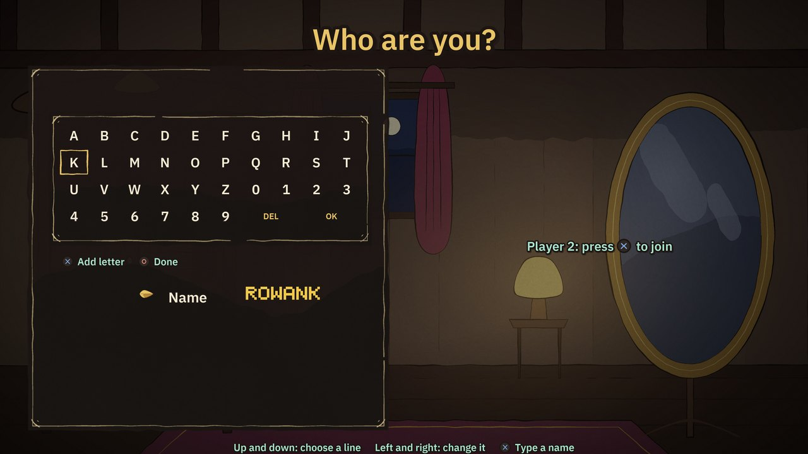 | 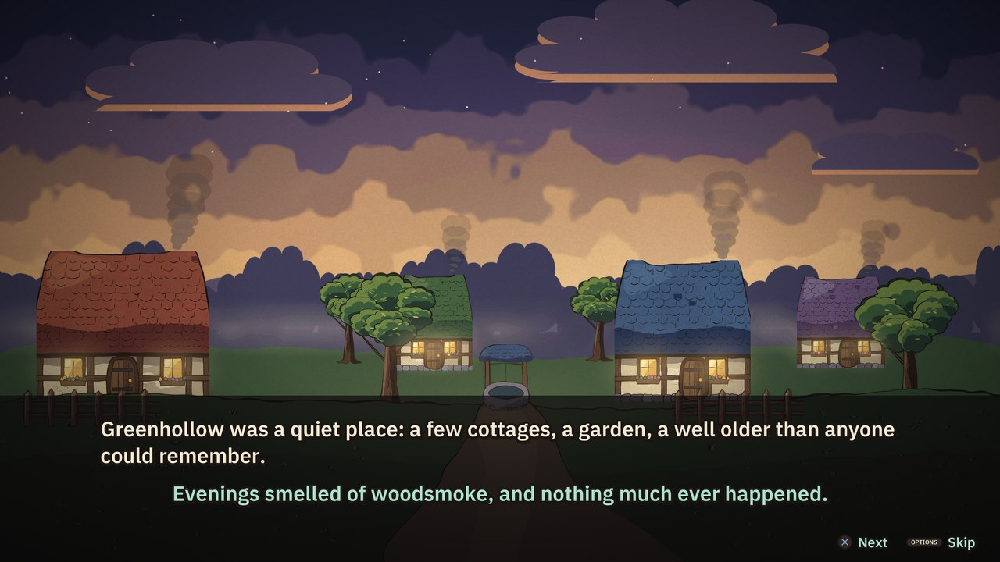 |
| Make your hero: class, skin, clothes, hair and a name | A short painted story to start |
| 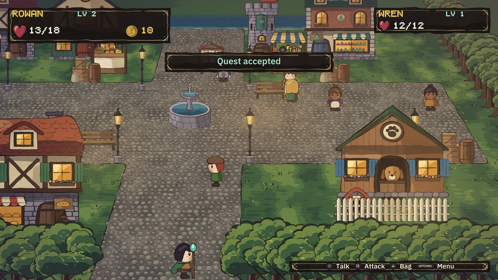 | 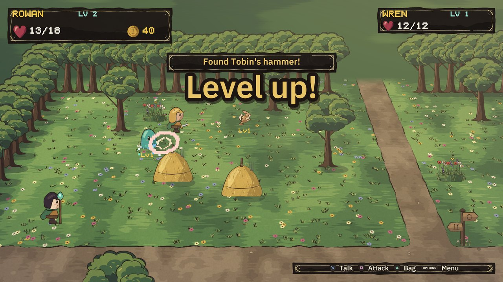 |
| Brookmere, the market town | The meadow |
| 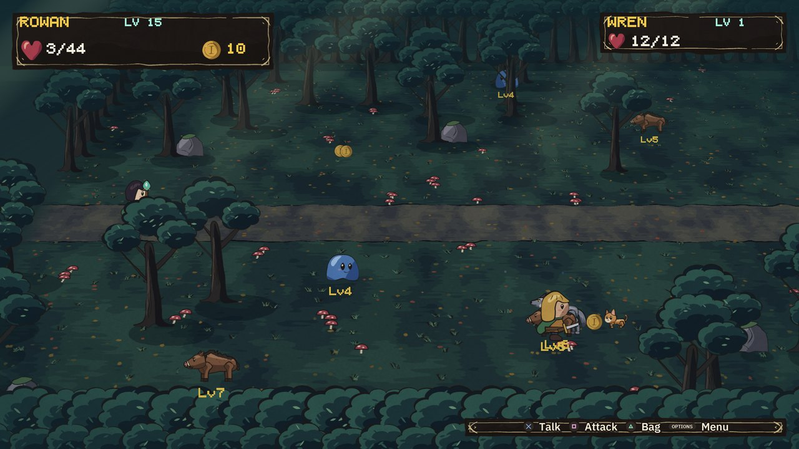 | 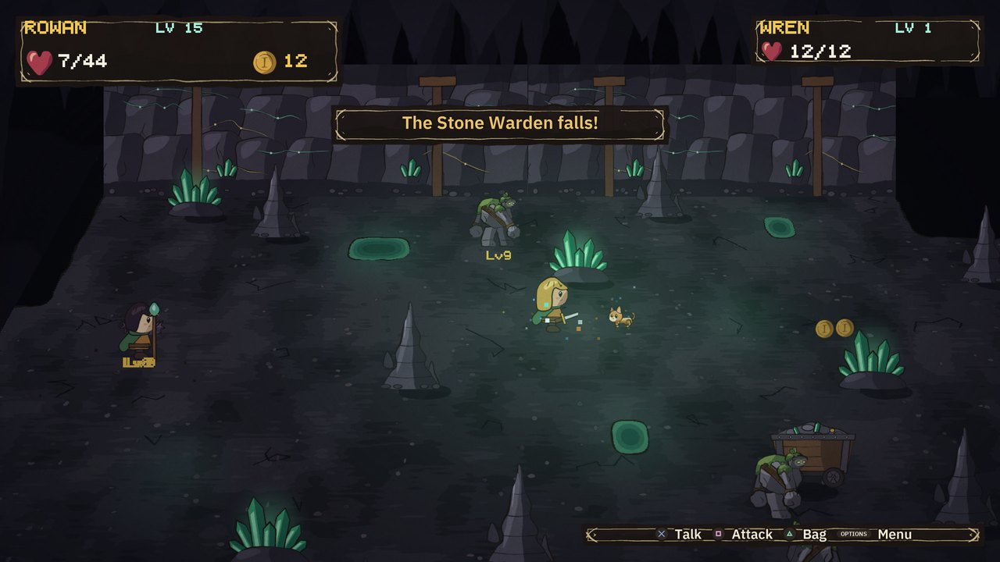 |
| Wolf packs and boars in the forest | The cave and its Stone Warden |
| 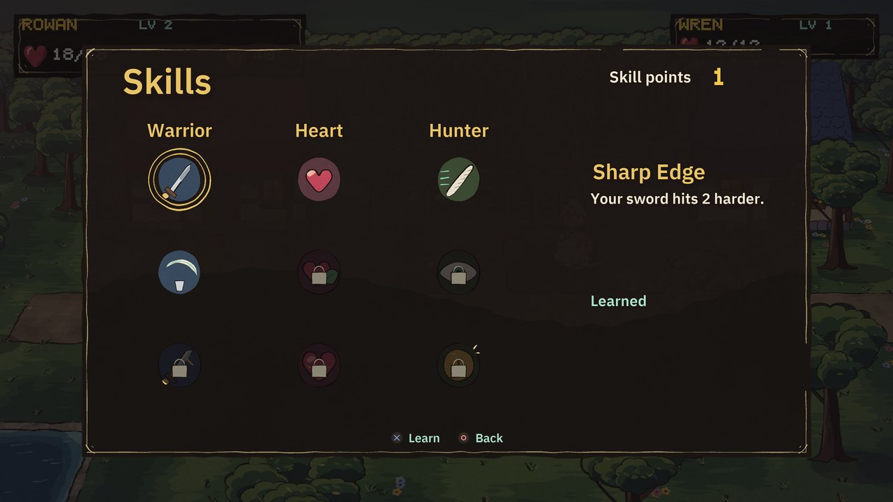 | 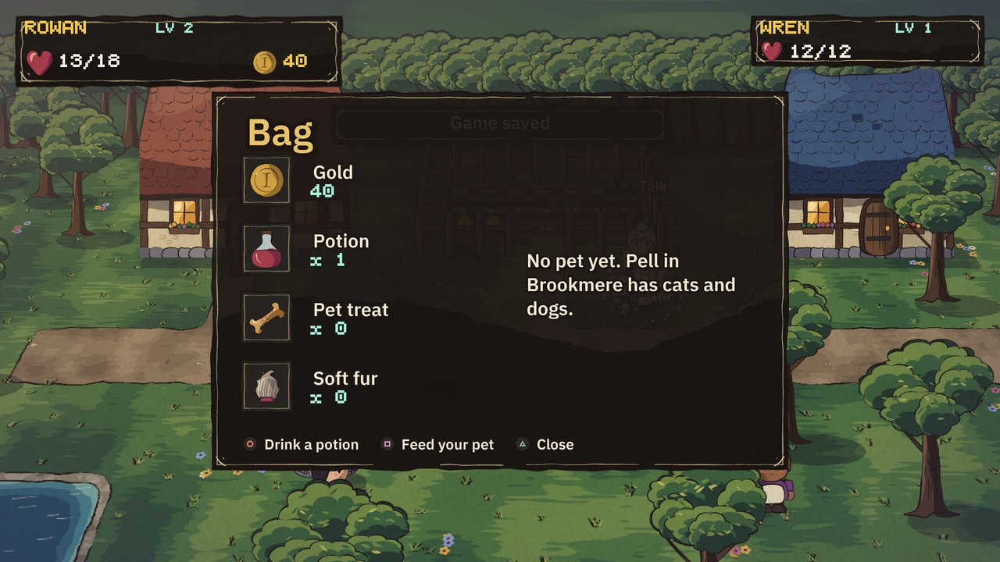 |
| A skill tree for each class | The bag |

## Playing online

Friends on the same network play one game, each on their own console. One hosts and the others choose Join a friend.
Each friend has a screen of their own: their own place in the world, camera, menus, bag and character.

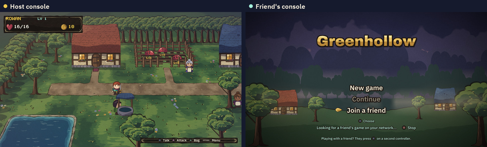

*The host just plays. On the other console, Join a friend looks for the game on the local network.*

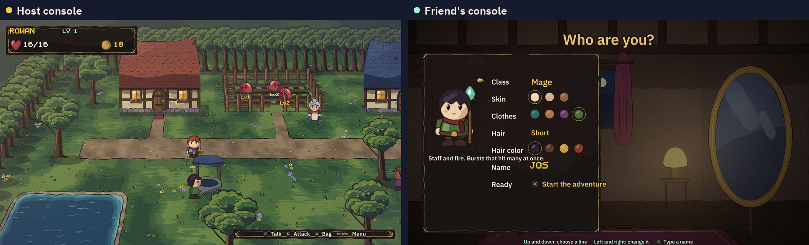

*A friend with no character makes one on their own screen, while the host keeps playing.*

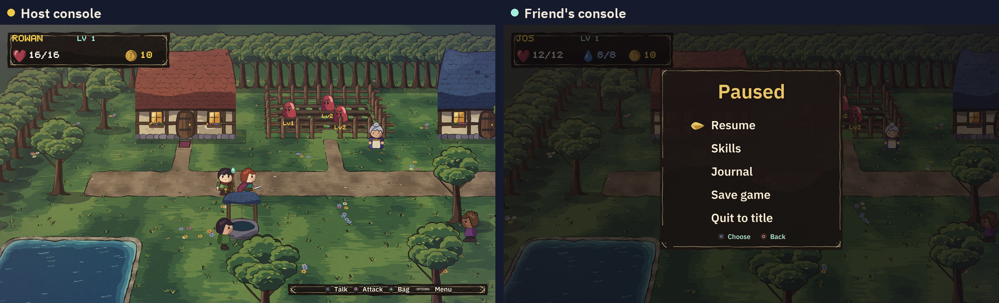

*Menus belong to a screen. The friend's pause menu shows on their console only, and stops nothing.*

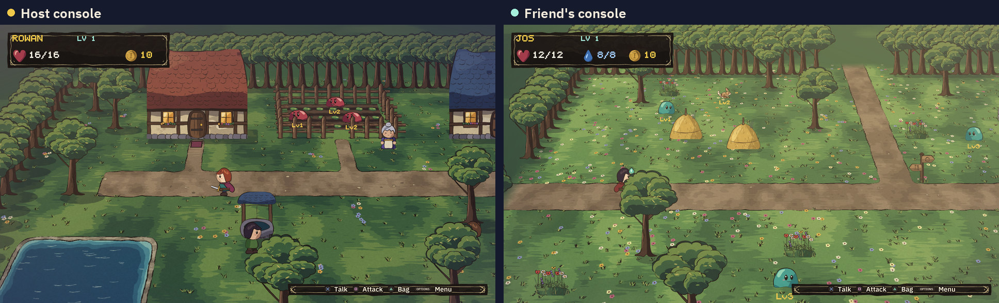

*You do not have to stay together: the host is in the village while the friend walks the meadow.*

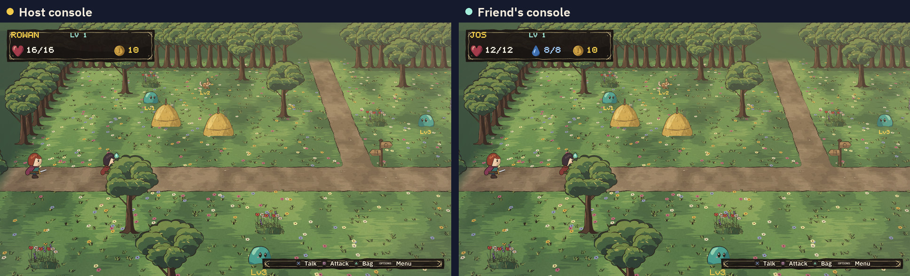

*Walk into the same place and you meet again, in one and the same world.*

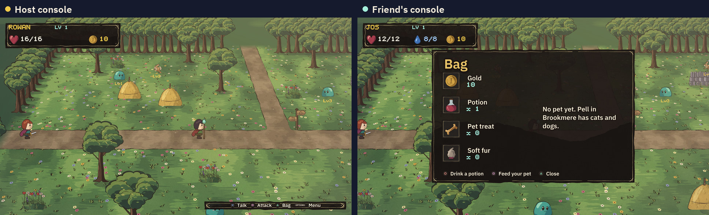

*Each console's card shows its own player, and each camera follows its own character.*

## What is in it

- **A story and your own hero.** A short painted intro, then make a Warrior, a Ranger or a Mage with your choice of
  skin, clothes, hair style and color, and a name typed on a letter grid.
- **Three ways to fight.** The Warrior swings a sword, the Ranger's arrows find the nearest creature in reach by themselves, and the Mage throws a
  fireball that bursts over a crowd and costs mana. Each class has its own skill branch; everyone shares the Heart and
  Hunter branches.
- **Six places.** Your village, Tobin's house, the meadow, Brookmere town, the forest and the cave.
- **Creatures with a temper.** Slimes that stay calm until hit, hoppers that run away, wolves that hunt in packs and call
  each other in, boars that charge once provoked, bat swarms, stone golems and the Stone Warden. Each has a level shown
  under it, drops gold or fur, and comes back after a while.
- **Five quests from six people.** Clear the three slimes from Mira's garden for good, find Tobin's lost hammer, bring Odo
  soft furs, thin Captain Rhea's wolf pack, and stop the Stone Warden for Dunn the miner. A journal keeps track.
- **A cat or a dog.** Adopt one at Pell's shelter. It follows you, bites what you fight, gets hungry, eats treats and
  grows up as it levels.
- **People about.** Townsfolk wander the village and Brookmere.
- **Two players on one screen.** A second controller joins on the title or while making characters, with their own hero,
  health, skills and pet. One who joins later in the game starts as a Ranger. The game's logic is written for up to four
  players.
- **Friends online, each on their own console.** On the same network, a friend picks Join a friend on their
  title and lands in your game with their own screen, camera, menus, bag and character, made on the spot if they
  have none. They can be in the forest while you are in town; the world is one and the same for everyone, and
  your save keeps their character. Up to three friends. A friend's menu does not stop the world.
- **A pause menu, saving and loading.** Resume, skills, journal, save, and quit to the title, where Continue picks up
  where you saved. Tobin's bed heals you and saves too.
- **Sounds made for it.** Swords, bows, fire, wolves, bats, a cat and a dog, and its own music for the title, the story,
  the village, the meadow, the town, the forest and the cave.

The whole game is one `scene.json` and one `logic.json`, about 12,800 blocks in all, with no hand-written game code. Open
it in Studio to see how each part is done.

## Download

From the [latest release](https://github.com/AnyDevStudio/Greenhollow/releases/latest):

| System | File | How to start |
|---|---|---|
| PS5 homebrew | `Greenhollow.ffpfsc` | Install it like any other `.ffpfsc` package |
| Windows x64 | `Greenhollow-windows-x64.zip` | Unzip the whole folder and run `Greenhollow.exe` |
| Linux x86_64 | `Greenhollow-linux-x64.tar.gz` | Unpack it and run `./Greenhollow` |
| Mac with Apple silicon, macOS 26 or newer | `Greenhollow-macos-arm64.zip` | Unzip, then see `README.txt`: the app is not signed, and needs Rosetta 2 |

The Windows and Linux builds run on the desktop libraries of [AnyPS5](https://github.com/boykopovar/AnyPS5), and the Mac
build on [AnyPS5-ARM](https://github.com/AnyTogether/AnyPS5-ARM). They need a graphics card with Vulkan; on a Mac that comes
in the app.

## Controls

| Action | Controller | Keyboard in AnyPS5 |
|---|---|---|
| Walk | Left stick or D-pad | WASD or arrow keys |
| Talk, next, choose, yes | Cross | Space or Enter |
| Attack, or feed your pet in the bag | Square | Left mouse button |
| Bag | Triangle | I |
| No, back, drink a potion in the bag | Circle | C |
| Menu | Options | Escape |

A second controller plays the second hero. To play online, start or continue a game on one console; on the other,
choose Join a friend on the title. Both must be on the same local network.

## Where it has run

- The first version of Greenhollow, with the village, the house and the forest, ran in the AnyPS5 compatibility layer on an
  Apple Silicon Mac at about 120 FPS, and its menus, saving and loading too.
- This version has been played through from start to finish by a scripted bot against the real game runtime on the host,
  under address and undefined behavior sanitizers. The bot plays two players and checks 81 things: the story, making two
  characters, every quest, the journal, skills, saving, the bag, a fireball, adopting and feeding a cat, the wolf pack, the
  Stone Warden, fainting, and loading the save back. `tools/gen_bot6.py` writes that bot.
- Playing online has been played through by a second bot, `tools/gen_bot6_online.py`: two copies of the game on
  one computer, talking over its network as two consoles would. It checks 41 things: finding and joining the host,
  making a character on the friend's own screen, each screen's own card, menus and bag, the two walking in two
  places at once and meeting again, each screen's own camera, leaving and coming back as the same character, and
  the host closing the game.
- The pictures on this page are drawn by a script from the game's real state at those moments. They are not captures
  from a GPU.
- This version has run in a window on an Apple Silicon Mac, made into a Mac app with AnyPS5-ARM's tools: the title
  drew at about 120 frames a second, and two copies of it on that one Mac played together online, one hosting and
  one joining. That is the only place it has been seen running, and nobody has checked every part of it there.
- It has not been run on a real PS5, on Windows or on Linux, nor online between two machines or over AnyTogether.

## Build

Get [AnyDevKit Studio](https://github.com/AnyDevStudio/AnyDevKit-Studio) 0.1.0-alpha.5 or newer, which has the blocks
for playing online (older versions cannot open this game), and set up its PS5 tools.
`CMakePresets.json` holds paths on your machine, so make it with `adk init` first:

```sh
adk init Greenhollow --deps <your .adk folder> --directory preset-source
cp preset-source/CMakePresets.json .
```

Then open this folder in Studio, pick a format next to the build button (PS5 package, Windows or Linux) and build. The PS5
package is `dist/ps5/Greenhollow.ffpfsc`, and the desktop builds are `dist/Greenhollow-windows-x64.zip` and
`dist/Greenhollow-linux-x64.tar.gz`.

## Art and sound

Every picture and sound is original and made by code, with no outside assets. `tools/art4.py` holds the ink-and-gouache
brush, and the `art6_*.py` files draw the people (in layers you can mix), the creatures and pets, the town and the cave,
the grounds, the story paintings and the screens. `tools/sound6.py` makes every sound and piece of music, and
`tools/make_game6.py` writes the scenes and blocks. To make everything again, with Python 3, Pillow and NumPy:

```sh
sh tools/build.sh
```

The same code always makes the same files.

## License

GPL-2.0-only, the license of the AnyDevKit template and runtime this game is built on. See [LICENSE](LICENSE)
and [LICENSES](LICENSES). The fonts in `tools/fonts` are under the SIL Open Font License.
