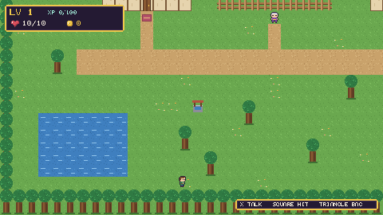

# Greenhollow

A small top-down pixel RPG for PS5 homebrew, made with
[AnyDevKit Studio](https://github.com/AnyDevStudio/AnyDevKit-Studio) from drag and drop scenes and jigsaw
logic blocks. It is an example from [AnyDevStudio](https://github.com/AnyDevStudio), built on
[AnyDevKit](https://github.com/boykopovar/AnyDevKit) by boykopovar.



Talk to Mira in the village and take her quest. Go through the east gate into the woods, cut down slimes,
pick up the jelly they drop and bring three back to her for gold, a potion and enough XP to level up.

- Three scenes: the village, a house you can walk into, and the forest
- Dialogue with a yes or no choice, and a quest tracker
- A bag with item counts and a potion you can drink
- Slimes that wander, chase you, hurt you, die, drop loot and come back
- Levels that raise your health and attack, a bed that heals you, and waking up in the village if you fall

The whole game is one `scene.json` and one `logic.json`, 1,221 blocks in all, with no hand-written game code.
Open it in Studio to see how each part is done.

## Controls

| Action | Controller | Keyboard in AnyPS5 |
|---|---|---|
| Walk | Left stick or D-pad | WASD or arrow keys |
| Talk, next, accept, sleep | Cross | Space or Enter |
| Sword | Square | Left mouse button |
| Bag | Triangle | I |
| Drink a potion, say no | Circle | C |

## Where it has run

It opened in the AnyPS5 compatibility layer on an Apple Silicon Mac at about 120 FPS, measured over the first
20 seconds. It has not been run on a real PS5.

The game logic was also played from start to finish by a scripted bot against the real game runtime on the
host, under address and undefined behavior sanitizers. `tools/gen_bot.py` writes that bot.

## Build

You need [AnyDevKit Studio](https://github.com/AnyDevStudio/AnyDevKit-Studio/releases) 0.1.0-alpha.3 or newer
with its PS5 tools set up. `CMakePresets.json` holds paths on your machine, so make it with `adk init` first:

```sh
adk init Greenhollow --deps <your .adk folder> --directory preset-source
cp preset-source/CMakePresets.json .
```

Then open this folder in Studio and press Build PS5 package. The prepared game folder is `build/package/app0`
and the single file package is `dist/ps5/Greenhollow.ffpfsc`.

## Art and sound

Every picture and sound is original and made by code, with no outside assets. `tools/art.py` draws the pixel art
and synthesizes the sound effects and music, and `tools/make_game.py` writes the scenes and blocks. Both need
Python 3 and, for the art, Pillow.

## License

GPL-2.0-only, the license of the AnyDevKit template and runtime this game is built on. See [LICENSE](LICENSE)
and [LICENSES](LICENSES).
